# Panadería El Trigo Dorado

## 1. El proyecto

Panadería El Trigo Dorado es un sitio web desarrollado para una panadería local que busca fortalecer su presencia en internet y facilitar la comunicación con sus clientes.

El público objetivo son personas interesadas en productos de panadería artesanal que desean conocer la oferta comercial del establecimiento, consultar precios, verificar horarios o realizar pedidos de manera rápida y sencilla.

La necesidad principal del cliente es contar con una plataforma web informativa que mejore la visibilidad del negocio, facilite el acceso a la información básica y contribuya a atraer nuevos clientes.


## 2. Estructura

El proyecto está organizado de la siguiente manera:

```text
├── index.html
├── pedidos.html
├── README.md
├── css/
│   └── styles.css
├── images/
│   └── Croissant.jpg
│   └── fondo.jpg
│   └── pan_campesino.jpg
│   └── pastel_chocolate-jpg
└── capturas/
```

### Etiquetas semánticas utilizadas

El proyecto está organizado en dos páginas principales:

1. `index.html`: página principal donde se presenta la panadería, los productos, horarios, opiniones de clientes y ubicación.
2. `pedidos.html`: página destinada a consultar los precios de los productos y realizar pedidos mediante un formulario.

    - `header`: Contiene el nombre de la panadería y el menú de navegación compartido por ambas las páginas.
    - `nav`: Permite al usuario desplazarse entre las diferentes secciones del sitio.
    - `main`: Agrupa el contenido principal de cada página, separándolo del encabezado y del pie de página.
    - `section`: Organiza el contenido en bloques temáticos como inicio, productos, información útil, opiniones, ubicación, precios y pedidos.
    - `article`: Se utiliza para representar contenidos independientes, como las tarjetas de productos y las opiniones de clientes.
    - `table`: se utiliza para presentar de forma estructurada la lista de precios de los productos.
    - `form`: Permite a los usuarios enviar información para realizar un pedido.
    - `footer`: Contiene información complementaria como datos de contacto y derechos del sitio.

## 3. Sistema visual

Se utilizaron variables CSS definidas en `:root`. Esto facilita la reutilización de estilos y permite realizar cambios globales de forma más sencilla.

<p align="center"></p>

### Colores

Se seleccionaron tonos marrones y dorados debido a su relación visual con el pan recién horneado y los productos de panadería artesanal.

- Color principal: utilizado en encabezados, botones y elementos destacados.
- Color secundario: empleado para resaltar secciones y elementos complementarios.
- Color de fondo claro: mejora la legibilidad del contenido.
- Color de texto oscuro: proporciona un contraste adecuado para facilitar la lectura.

### Fuentes
Se utilizó la fuente Arial, Helvetica, sans-serif porque es una tipografía ampliamente disponible, fácil de leer y adecuada para contenidos informativos tanto en dispositivos móviles como de escritorio.

### Espaciado

La variable --espacio se utiliza para mantener una separación uniforme entre secciones, tarjetas y formularios, mejorando la organización visual del sitio.

###  Bordes redondeados

La variable --radio se emplea para aplicar bordes redondeados a componentes como tarjetas y formularios. Esto aporta una apariencia más moderna y amigable para el usuario.

## 4. Especificidad 

### Conflicto 1: Listas de la sección Información

### Especificidad

| Regla             | Especificidad | Conflicto|
| ----------------- | ------------- | ------------- |
| `section ul`      | (0,0,2)       |  `display inline-block`, `padding-left1.75rem`  |            
| `#informacion ul` | (1,0,1)       |  `display block` , `padding-left2rem`     |

<p align="center"></p>

- Gana `#informacion ul` 
- Analisis: Porque contiene un ID. Su especificidad (1,0,1) es mayor que la de `section ul` (0,0,2), por lo que las propiedades de la segunda regla sobrescriben a las de la primera.

### Conflicto 2: Tarjetas de opiniones

### Especificidad

| Regla                | Especificidad (ID, Clase, Etiqueta) | Propiedades en conflicto                                                          |
| -------------------- | ----------------------------------- | --------------------------------------------------------------------------------- |
| `.opinion-card`      | (0,1,0)                             | `background-color: rgba(255,255,255,.85)`, `margin: 1rem auto`, `padding: 1.5rem` |
| `#opiniones article` | (1,0,1)                             | `background-color: var(--color-blanco)`, `margin: 1rem 0`, `padding: 1rem`        |

<p align="center"></p>

- Gana: #opiniones article

- Análisis:
 La regla #opiniones article gana porque contiene un ID. Su especificidad (1,0,1) es mayor que la de .opinion-card (0,1,0), por lo que reemplaza las propiedades background-color, margin y padding definidas en la clase .opinion-card.

 ### Conflicto 3: Tarjetas de información (empate resuelto por orden)


 | Regla          | Especificidad (ID, Clase, Etiqueta) | Propiedades en conflicto                                                      |
| -------------- | ----------------------------------- | ----------------------------------------------------------------------------- |
| `.info-bloque` | (0,1,0)                             | `display: inline-block`, `vertical-align: top`, `width: 45%`, `margin: 1rem`  |
| `.info-card`   | (0,1,0)                             | `display: inline-block`, `vertical-align: top`, `width: 45%`, `margin: .5rem` |

<p align="center"></p>

- Gana: .info-card

- Análisis:
 Ambas reglas tienen la misma especificidad (0,1,0) porque ambas utilizan una sola clase. Al existir un empate, CSS aplica la regla que aparece más tarde en la hoja de estilos. Por esta razón, el valor margin: .5rem de `.info-card` reemplaza al valor margin: 1rem definido en `.info-bloque`.

## 5. Herencia

### Propiedad que SI hereda: `font-family`

La propiedad `font-family` se definió en el elemento `body`:

```css
body {
    font-family: var(--fuente-principal);
}

```
Esta propiedad se hereda automáticamente por los elementos hijos. Se observa en los títulos, párrafos, listas y enlaces de las páginas.

<p align="center">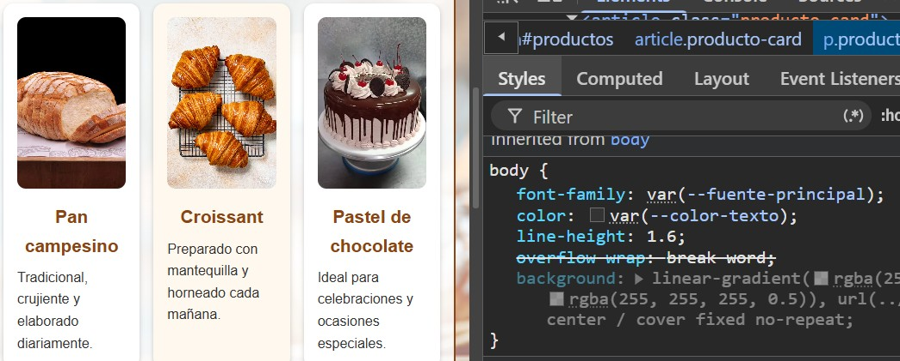</p>

Lugar donde se nota: sección "Nuestros productos" y formulario de pedidos.

### Propiedad que NO hereda: `border-top`

La propiedad `border-top` se definió en las `section`:
```css
section {
    border-top: 4px solid var(--color-acento);
}
```
Esta propiedad no se hereda. En la sección "Información útil" el borde superior naranja se aplica únicamente al elemento section, pero los elementos internos como div, listas y párrafos no reciben ese borde automáticamente.

La Figura 1 muestra el borde superior aplicado a la sección.

<p align="center">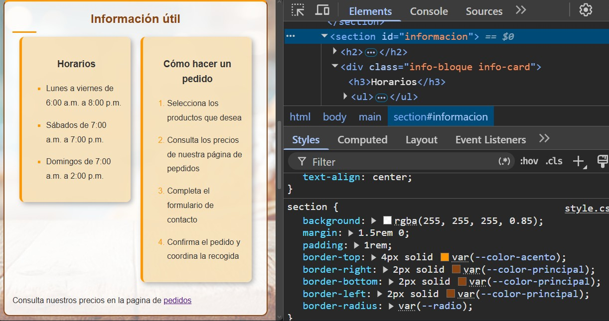</p>

La Figura 2 muestra un elemento hijo (div.info-card) donde no aparece la propiedad border-top, demostrando que no fue heredada.

<p align="center">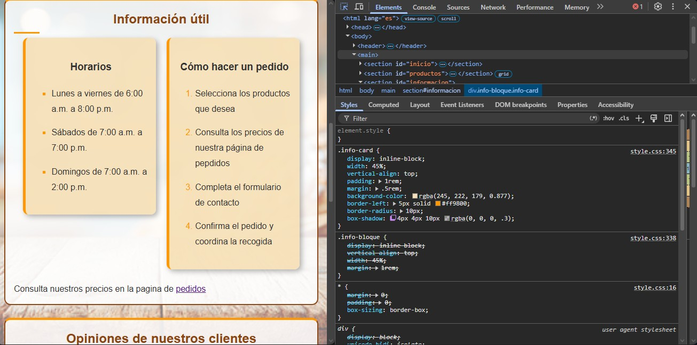</p>

## 6. Modelo de cajas 

### Cálculo del ancho total de un componente (formulario)

Se utilizó el formulario de la página `pedidos.html`.
```css
form {
    max-width: 900px;
    margin: 2rem auto;
    padding: 2rem;
    background-color: rgba(255, 248, 238, 0.9);
    border: 2px solid var(--color-acento);
    border-radius: 12px;
    box-shadow: 0 4px 12px rgba(139, 69, 19, .2);
}
``` 

### Medidas del componente

| Elemento            | Valor |
| ------------------- | ----- |
| Ancho del contenido | 900px |
| Padding izquierdo   | 32px  |
| Padding derecho     | 32px  |
| Borde izquierdo     | 2px   |
| Borde derecho       | 2px   |

### Cálculo
El ancho total de una caja se obtiene sumando: 
Contenido + Padding izquierdo + Padding derecho + Borde izquierdo + Borde derecho

Aplicando los valores del formulario: 900px + 32px + 32px + 2px + 2px = 968px


```css
* {
    box-sizing: border-box;
}
```
Sin embargo, el proyecto utiliza box-sizing: border-box, por lo que el navegador incluye el padding y los bordes dentro de los 900px definidos por max-width. Por esta razón, el formulario mantiene un ancho visible máximo de 900px y no aumenta hasta 968px.

<p align="center">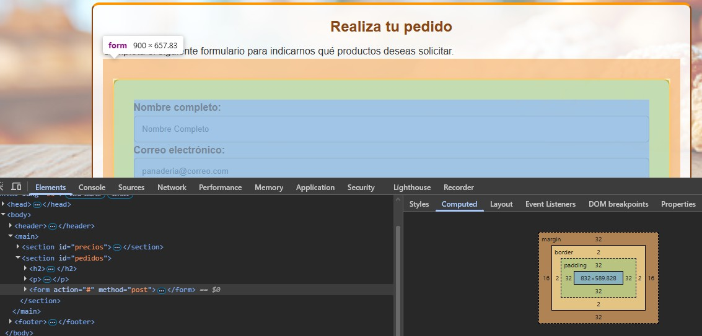</p>

## 7. Selectores

### Pseudoclase estructural: `:nth-of-type(even)`

En la sección de productos se utilizó la pseudoclase estructural `:nth-of-type(even)`:

```css
#productos .producto-card:nth-of-type(even) {
    background-color: #fff8ee;
}
```
Esta pseudoclase cuenta los elementos hermanos del mismo tipo dentro del contenedor `#productos` y aplica los estilos a aquellos que ocupan posiciones pares.

| Producto | ¿Recibe el estilo? |
|-----------|-----------|
| Primer producto | No |
| Segundo producto | Sí |
| Tercer producto |  No |

La regla termina aplicándose al segundo producto ("Croissant"), ya que ocupa una posición par entre los elementos hermanos de tipo article. Permitiendo diferenciar visualmente algunas tarjetas de productos mediante un color de fondo distinto.

<p align="center">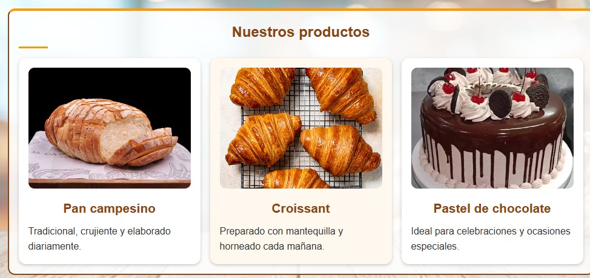</p>

## 8. Responsive

Para adaptar el sitio a dispositivos móviles se utilizó la siguiente media query:

```css
@media (max-width: 360px)
```

Cuando el ancho de la pantalla es igual o inferior a 360px, se aplican varios cambios para mejorar la visualización y la usabilidad.

| Elemento                | Cambio realizado                                                           | Motivo                                             |
| ----------------------- | -------------------------------------------------------------------------- | -------------------------------------------------- |
| Menú de navegación      | Los enlaces pasan de mostrarse en línea a mostrarse en bloques verticales. | Facilita el acceso desde pantallas pequeñas.       |
| Tarjetas de productos   | La cuadrícula pasa de tres columnas a una sola columna.                    | Evita que las tarjetas queden demasiado estrechas. |
| Tarjetas de información | Aumentan su ancho al 95% y se muestran una debajo de otra.                 | Mejora la lectura en dispositivos móviles.         |
| Mapa                    | Se adapta al ancho disponible y reduce su altura.                          | Evita el desbordamiento horizontal.                |
| Tabla de precios        | Permite desplazamiento horizontal mediante scroll.                         | Mantiene la legibilidad sin romper el diseño.      |
| Botones                 | Pasan a ocupar el ancho disponible.                                        | Facilita su uso en pantallas táctiles.             |

## 9. Problemas y soluciones

### Problema 1: Marcadores de listas mal alineados

**Problema**

Los números de las listas ordenadas (`ol`) y los marcadores de las listas desordenadas (`ul`) no tenían una separación adecuada respecto al contenido, lo que afectaba la legibilidad.

**Causa**

El espaciado aplicado a las listas no era suficiente para separar correctamente los marcadores y el texto.

**Solución**

Se ajustó la propiedad `padding-left` de las listas para aumentar la separación y mejorar la presentación visual.

```css
#informacion ul,
#informacion ol {
    padding-left: 2rem;
}
```

### Problema 2: Superposición de la comilla decorativa en las opiniones

**Problema**

La comilla decorativa utilizada en las opiniones de los clientes se superponía al texto de las citas, afectando la legibilidad.

**Causa**

El pseudoelemento `blockquote::before` utiliza posicionamiento absoluto para colocar la comilla decorativa. Inicialmente, su posición no dejaba suficiente espacio respecto al contenido de la cita.

**Solución**

Se añadió espacio superior al blockquote y se ajustó la posición de la comilla decorativa para evitar la superposición.

```css
blockquote {
    padding-top: 1.5rem;
}

blockquote::before {
    top: -15px;
    left: -10px;
}
```

## 10. Capturas 

## 10. Capturas

### Página principal (escritorio)

<p align="center">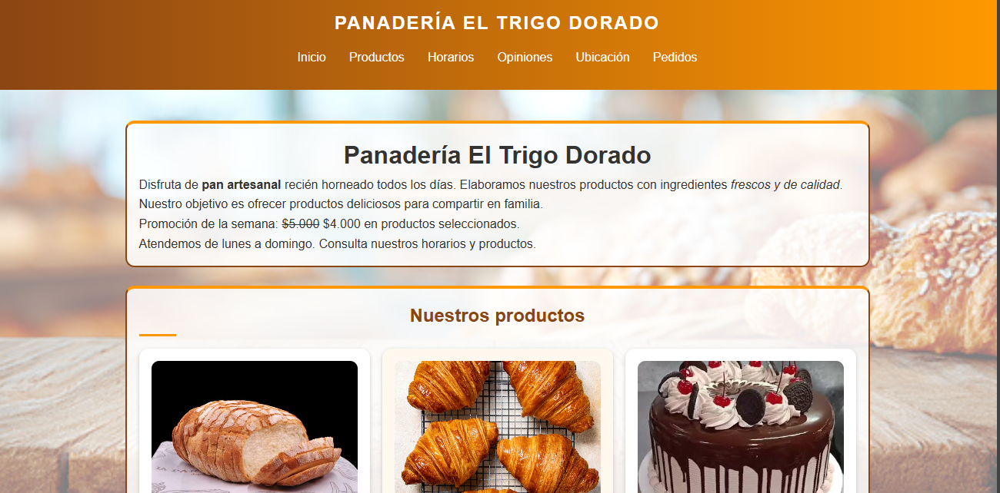</p>
<p align="center">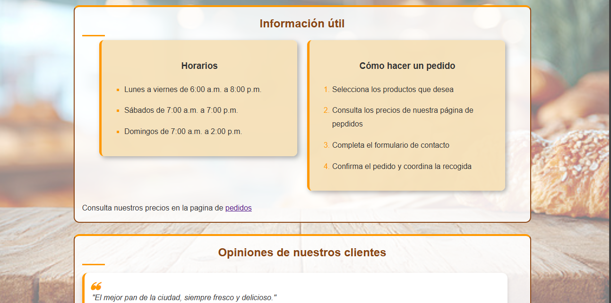</p>

### Página de pedidos (escritorio)

<p align="center">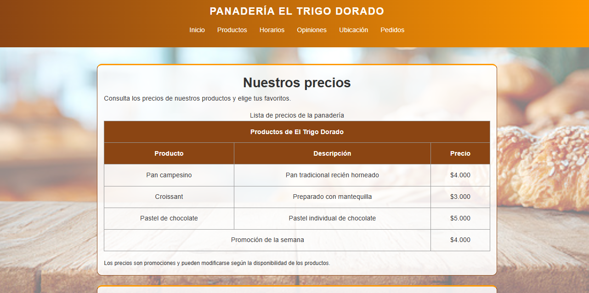</p>
<p align="center">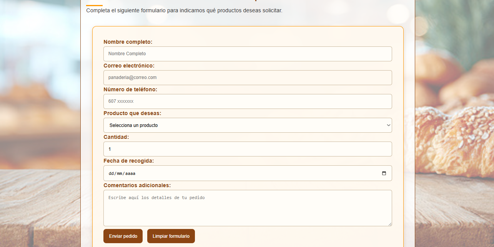</p>

### Página principal (360 px)

<p align="center">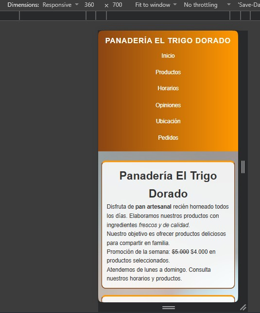</p>
<p align="center">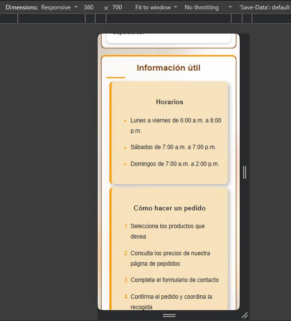</p>

### Página de pedidos (360 px)

<p align="center">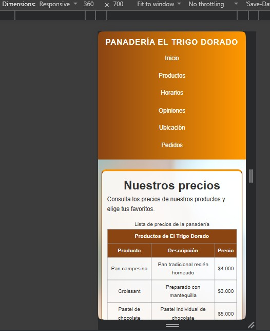</p>
<p align="center">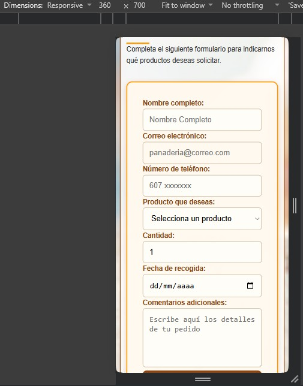</p>

