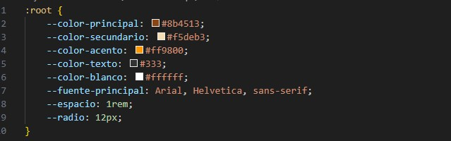
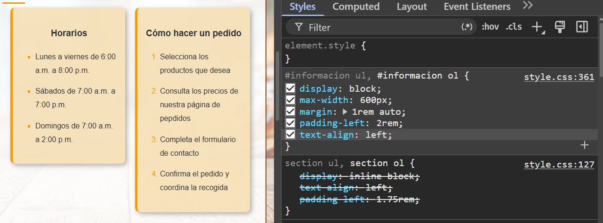
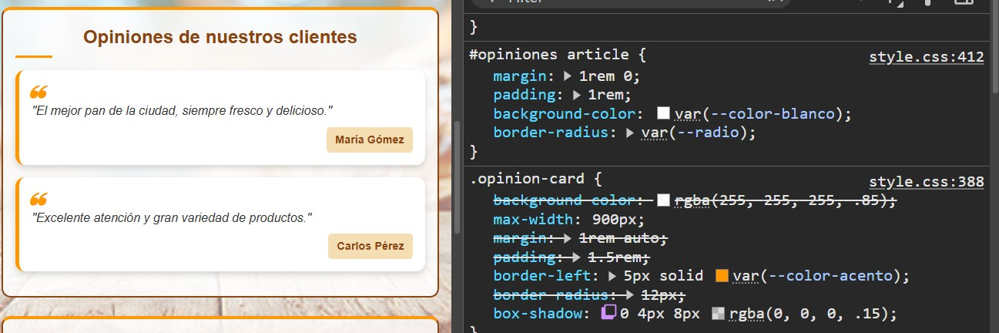
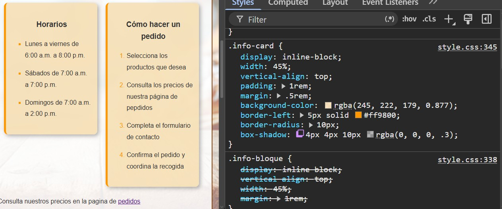

# Panadería El Trigo Dorado

## 1. El proyecto

Panadería El Trigo Dorado es un sitio web desarrollado para una panadería local que busca fortalecer su presencia en internet y facilitar la comunicación con sus clientes.

El público objetivo son personas interesadas en productos de panadería artesanal que desean conocer la oferta comercial del establecimiento, consultar precios, verificar horarios o realizar pedidos de manera rápida y sencilla.

La necesidad principal del cliente es contar con una plataforma web informativa que mejore la visibilidad del negocio, facilite el acceso a la información básica y contribuya a atraer nuevos clientes.


## 2. Estructura

El proyecto está organizado de la siguiente manera:

```text
├── index.html
├── pedidos.html
├── README.md
├── css/
│   └── styles.css
├── images/
│   └── Croissant.jpg
│   └── fondo.jpg
│   └── pan_campesino.jpg
│   └── pastel_chocolate-jpg
└── capturas/
```

### Etiquetas semánticas utilizadas

El proyecto está organizado en dos páginas principales:

1. `index.html`: página principal donde se presenta la panadería, los productos, horarios, opiniones de clientes y ubicación.
2. `pedidos.html`: página destinada a consultar los precios de los productos y realizar pedidos mediante un formulario.

    - `header`: Contiene el nombre de la panadería y el menú de navegación compartido por ambas las páginas.
    - `nav`: Permite al usuario desplazarse entre las diferentes secciones del sitio.
    - `main`: Agrupa el contenido principal de cada página, separándolo del encabezado y del pie de página.
    - `section`: Organiza el contenido en bloques temáticos como inicio, productos, información útil, opiniones, ubicación, precios y pedidos.
    - `article`: Se utiliza para representar contenidos independientes, como las tarjetas de productos y las opiniones de clientes.
    - `table`: se utiliza para presentar de forma estructurada la lista de precios de los productos.
    - `form`: Permite a los usuarios enviar información para realizar un pedido.
    - `footer`: Contiene información complementaria como datos de contacto y derechos del sitio.

## 3. Sistema visual

Se utilizaron variables CSS definidas en `:root`. Esto facilita la reutilización de estilos y permite realizar cambios globales de forma más sencilla.

<p align="center"></p>

### Colores

Se seleccionaron tonos marrones y dorados debido a su relación visual con el pan recién horneado y los productos de panadería artesanal.

- Color principal: utilizado en encabezados, botones y elementos destacados.
- Color secundario: empleado para resaltar secciones y elementos complementarios.
- Color de fondo claro: mejora la legibilidad del contenido.
- Color de texto oscuro: proporciona un contraste adecuado para facilitar la lectura.

### Fuentes
Se utilizó la fuente Arial, Helvetica, sans-serif porque es una tipografía ampliamente disponible, fácil de leer y adecuada para contenidos informativos tanto en dispositivos móviles como de escritorio.

### Espaciado

La variable --espacio se utiliza para mantener una separación uniforme entre secciones, tarjetas y formularios, mejorando la organización visual del sitio.

###  Bordes redondeados

La variable --radio se emplea para aplicar bordes redondeados a componentes como tarjetas y formularios. Esto aporta una apariencia más moderna y amigable para el usuario.

## 4. Especificidad 

### Conflicto 1: Listas de la sección Información

### Especificidad

| Regla             | Especificidad | Conflicto|
| ----------------- | ------------- | ------------- |
| `section ul`      | (0,0,2)       |  `display inline-block`, `padding-left1.75rem`  |            
| `#informacion ul` | (1,0,1)       |  `display block` , `padding-left2rem`     |

<p align="center"></p>

- Gana `#informacion ul` 
- Analisis: Porque contiene un ID. Su especificidad (1,0,1) es mayor que la de `section ul` (0,0,2), por lo que las propiedades de la segunda regla sobrescriben a las de la primera.

### Conflicto 2: Tarjetas de opiniones

### Especificidad

| Regla                | Especificidad (ID, Clase, Etiqueta) | Propiedades en conflicto                                                          |
| -------------------- | ----------------------------------- | --------------------------------------------------------------------------------- |
| `.opinion-card`      | (0,1,0)                             | `background-color: rgba(255,255,255,.85)`, `margin: 1rem auto`, `padding: 1.5rem` |
| `#opiniones article` | (1,0,1)                             | `background-color: var(--color-blanco)`, `margin: 1rem 0`, `padding: 1rem`        |

<p align="center"></p>

- Gana: #opiniones article

- Análisis:
 La regla #opiniones article gana porque contiene un ID. Su especificidad (1,0,1) es mayor que la de .opinion-card (0,1,0), por lo que reemplaza las propiedades background-color, margin y padding definidas en la clase .opinion-card.

 ### Conflicto 3: Tarjetas de información (empate resuelto por orden)


 | Regla          | Especificidad (ID, Clase, Etiqueta) | Propiedades en conflicto                                                      |
| -------------- | ----------------------------------- | ----------------------------------------------------------------------------- |
| `.info-bloque` | (0,1,0)                             | `display: inline-block`, `vertical-align: top`, `width: 45%`, `margin: 1rem`  |
| `.info-card`   | (0,1,0)                             | `display: inline-block`, `vertical-align: top`, `width: 45%`, `margin: .5rem` |

<p align="center"></p>

- Gana: .info-card

- Análisis:
 Ambas reglas tienen la misma especificidad (0,1,0) porque ambas utilizan una sola clase. Al existir un empate, CSS aplica la regla que aparece más tarde en la hoja de estilos. Por esta razón, el valor margin: .5rem de `.info-card` reemplaza al valor margin: 1rem definido en `.info-bloque`.